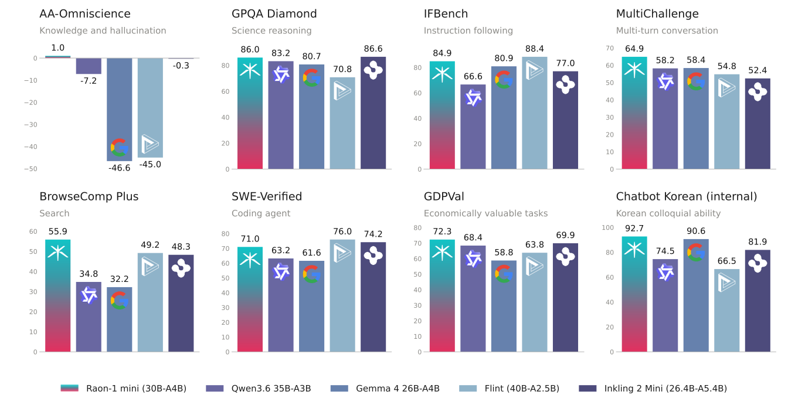

# Raon-1 mini

<div align="center">
  <picture>
    <source media="(prefers-color-scheme: dark)" srcset="assets/raon-1-mini-logo-dark.png">
    
  </picture>
</div>

<p align="center">
  <a href="https://krafton.ai/en/"></a>
  <a href="https://huggingface.co/KRAFTON"></a>
  <a href="https://www.apache.org/licenses/LICENSE-2.0"></a>
  <br>
  <a href="https://x.com/Krafton_AI"></a>
  <a href="https://discord.gg/sDG7mmZPnc"></a>
</p>

Raon-1 mini is a 30B-A4B Mixture-of-Experts (MoE) language model, designed and **trained from scratch** by [KRAFTON AI](https://krafton.ai/en/). It demonstrates **strong capabilities in Korean conversation and agentic tasks**. As part of the Raon open model family, it is released under the **Apache 2.0 license**.

## Highlights

- **Reasoning**: Built-in thinking with six [reasoning effort](#reasoning-effort) levels (`none`, `low`, `medium`, `high`, `xhigh` and `max`), selectable per request. Scores 96.7 on AIME 2026, 87.1 on HMMT Feb 2026 and 86.0 on GPQA Diamond.
- **Multi-turn conversation and search**: Leads the compared MoE models on MultiChallenge (64.9) and BrowseComp Plus (55.9), the multi-turn conversation and search benchmarks shown below.
- **Multilingual capabilities**: Trained on Korean, English, Japanese, Chinese, Spanish, French, and Thai. Demonstrates strong Korean performance and solid English capabilities.
- **Agent execution**: Tool calling for agentic workflows, with support for Hermes Agent, Pi and OpenCode.
- **Speculative decoding support**: A DFlash2 draft model is provided for accelerated speculative decoding.
- **Quantization options**: Available in MXFP8 and NVFP4 formats, with NVFP4 enabling inference on a single NVIDIA RTX 5090 gpu (32 GB VRAM).

<p align="center">
  <picture>
    <source media="(prefers-color-scheme: dark)" srcset="assets/raon-1-mini-highlights-dark.svg">
    
  </picture>
</p>

## Model Overview

Raon-1 mini uses a hybrid Mixture-of-Experts (MoE) architecture, consisting of 18 linear attention layers and 7 full attention layers.

- **Raon Delta Attention (RDA):** Raon Delta Attention decouples the erase and write gates of Kimi Delta Attention, which improves long-context performance over KDA.
- **Raon-mHC:** Raon-mHC reduces the computational cost of DeepSeek’s manifold-constrained hyper-connections (mHC), which speeds up training.
- **Hybrid layout:** 18 of the 25 layers are Raon Delta Attention layers with a fixed-size state. Only the 7 MLA layers keep a KV cache, about 8 KiB per token in BF16.
- **Long context:** Natively supports up to 262,144 tokens of context.
- **Sparse MoE:** 6 of 128 routed experts plus 1 shared expert are active per token, so each token uses 4.3B of the 28.8B total parameters.

| Field | Value |
|---|---|
| Architecture | MoE |
| Total Parameters | 28.8B |
| Activated Parameters | 4.3B |
| Layers | 25 |
| Hidden Size | 2,560 |
| Attention | Hybrid — RDA 3 : Gated MLA 1 |
| Position Encoding | NoPE (no positional encoding) |
| Number of Attention Heads | 40 for both RDA & Gated MLA |
| Attention Head Dimension | 128 for RDA; 192 QK / 128 V, for Gated MLA |
| Query / KV LoRA Rank | 576 / 512, for Gated MLA |
| Number of Experts | 128 |
| Number of Activated Experts | 6 routed + 1 shared |
| Expert Intermediate Size | 1,088 |
| Dense FFN Intermediate Size (first layer)| 12,032 |
| Activation Function | SiTU-GLU |
| Residual Connection | Raon-mHC w/ 4 streams |
| Vocabulary Size | 259,840 |
| LM Head | Untied |
| Context Length | 262,144 tokens |

---

## Benchmark Results

Red indicates the best performance of Raon-1 mini preview among MoE baselines.

<table style="font-family:'Pretendard','Noto Sans KR','Apple SD Gothic Neo','Malgun Gothic',system-ui,sans-serif;border-collapse:collapse;width:100%;table-layout:auto;font-size:14px;max-width:1400px;margin:0 auto">
  <colgroup>
    <col style="width:12%">
    <col style="width:16%">
    <col span="8" style="width:9%">
  </colgroup>
  <thead>
  <tr>
    <th rowspan="2" style="background:#000;color:#fff;text-align:left;padding:12px 14px;font-weight:700;vertical-align:middle">Category</th>
    <th rowspan="2" style="background:#000;color:#fff;text-align:left;padding:12px 14px;font-weight:700;vertical-align:middle">Benchmark</th>
    <th colspan="6" style="background:#000;color:#fff;padding:10px 12px;font-weight:700;text-align:center">MoE</th>
    <th colspan="2" style="background:#000;color:#fff;padding:10px 12px;font-weight:700;text-align:center;border-left:2px solid #9a9a9a">Dense</th>
  </tr>
  <tr>
    <th style="min-width:60px;box-sizing:border-box;padding:10px 6px;font-weight:600;font-size:13px;color:#fff;text-align:center;line-height:1.35;background:#e0362f">Raon-1 mini<br/>(30B-A4B)</th>
    <th style="min-width:60px;box-sizing:border-box;padding:10px 6px;font-weight:600;font-size:13px;color:#fff;text-align:center;line-height:1.35;background:#e0362f">Raon-1 mini preview</th>
    <th style="min-width:60px;box-sizing:border-box;padding:10px 6px;font-weight:600;font-size:13px;color:#fff;text-align:center;line-height:1.35;background:#2a2a2a">Qwen3.6-35B-A3B</th>
    <th style="min-width:60px;box-sizing:border-box;padding:10px 6px;font-weight:600;font-size:13px;color:#fff;text-align:center;line-height:1.35;background:#2a2a2a">Gemma 4 26B-A4B</th>
    <th style="min-width:60px;box-sizing:border-box;padding:10px 6px;font-weight:600;font-size:13px;color:#fff;text-align:center;line-height:1.35;background:#2a2a2a">Flint<br/>(40B-A2.5B)</th>
    <th style="min-width:60px;box-sizing:border-box;padding:10px 6px;font-weight:600;font-size:13px;color:#fff;text-align:center;line-height:1.35;background:#2a2a2a">Inkling 2 Mini<br/>(26.4B-A5.4B)</th>
    <th style="min-width:60px;box-sizing:border-box;padding:10px 6px;font-weight:600;font-size:13px;color:#fff;text-align:center;line-height:1.35;background:#2a2a2a;border-left:2px solid #9a9a9a">Qwen3.8-27B</th>
    <th style="min-width:60px;box-sizing:border-box;padding:10px 6px;font-weight:600;font-size:13px;color:#fff;text-align:center;line-height:1.35;background:#2a2a2a">Muse Glimmer 30B</th>
  </tr>
  </thead>
  <tbody>
  <tr>
    <td rowspan="2" style="font-weight:700;text-align:left;vertical-align:middle;white-space:normal;border-bottom:1px solid #e6e6e6;background:#fff;color:#1a1a1a">Knowledge</td>
    <td style="padding:12px 10px;border-bottom:1px solid #e6e6e6;color:#1a1a1a;font-weight:500;text-align:left;white-space:normal;background:#fff">MMLU Pro</td>
    <td style="padding:12px 6px;border-bottom:1px solid #e6e6e6;text-align:center;color:#1a1a1a;font-size:15px;background:#fef0ef">82.7</td>
    <td style="padding:12px 6px;border-bottom:1px solid #e6e6e6;text-align:center;color:#1a1a1a;font-size:15px;background:#fef0ef">76.5</td>
    <td style="padding:12px 6px;border-bottom:1px solid #e6e6e6;text-align:center;color:#1a1a1a;font-size:15px;background:#fff">85.9</td>
    <td style="padding:12px 6px;border-bottom:1px solid #e6e6e6;text-align:center;color:#1a1a1a;font-size:15px;background:#fff">82.9</td>
    <td style="padding:12px 6px;border-bottom:1px solid #e6e6e6;text-align:center;color:#1a1a1a;font-size:15px;background:#fff">77.7</td>
    <td style="padding:12px 6px;border-bottom:1px solid #e6e6e6;text-align:center;color:#1a1a1a;font-size:15px;background:#fff">83.5</td>
    <td style="padding:12px 6px;border-bottom:1px solid #e6e6e6;text-align:center;color:#1a1a1a;font-size:15px;border-left:2px solid #9a9a9a;background:#fff">85.7</td>
    <td style="padding:12px 6px;border-bottom:1px solid #e6e6e6;text-align:center;color:#1a1a1a;font-size:15px;background:#fff">84.0</td>
  </tr>
  <tr>
    <td style="padding:12px 10px;border-bottom:1px solid #e6e6e6;color:#1a1a1a;font-weight:500;text-align:left;white-space:normal;background:#f7f7f7">AA-Omniscience</td>
    <td style="padding:12px 6px;border-bottom:1px solid #e6e6e6;text-align:center;color:#1a1a1a;font-size:15px;background:#fde4e2">1.0</td>
    <td style="padding:12px 6px;border-bottom:1px solid #e6e6e6;text-align:center;color:#e32e5e;font-size:15px;background:#fde4e2">3.5</td>
    <td style="padding:12px 6px;border-bottom:1px solid #e6e6e6;text-align:center;color:#1a1a1a;font-size:15px;background:#f7f7f7">−7.2</td>
    <td style="padding:12px 6px;border-bottom:1px solid #e6e6e6;text-align:center;color:#1a1a1a;font-size:15px;background:#f7f7f7">−46.6</td>
    <td style="padding:12px 6px;border-bottom:1px solid #e6e6e6;text-align:center;color:#1a1a1a;font-size:15px;background:#f7f7f7">−45.0</td>
    <td style="padding:12px 6px;border-bottom:1px solid #e6e6e6;text-align:center;color:#1a1a1a;font-size:15px;background:#f7f7f7">−0.3</td>
    <td style="padding:12px 6px;border-bottom:1px solid #e6e6e6;text-align:center;color:#1a1a1a;font-size:15px;background:#f7f7f7;border-left:2px solid #9a9a9a">−0.5</td>
    <td style="padding:12px 6px;border-bottom:1px solid #e6e6e6;text-align:center;color:#1a1a1a;font-size:15px;background:#f7f7f7">−34.7</td>
  </tr>
  <tr>
    <td rowspan="3" style="font-weight:700;text-align:left;vertical-align:middle;white-space:normal;border-bottom:1px solid #e6e6e6;background:#fff;color:#1a1a1a">Reasoning</td>
    <td style="padding:12px 10px;border-bottom:1px solid #e6e6e6;color:#1a1a1a;font-weight:500;text-align:left;white-space:normal;background:#fff">GPQA Diamond</td>
    <td style="padding:12px 6px;border-bottom:1px solid #e6e6e6;text-align:center;color:#1a1a1a;font-size:15px;background:#fef0ef">86.0</td>
    <td style="padding:12px 6px;border-bottom:1px solid #e6e6e6;text-align:center;color:#1a1a1a;font-size:15px;background:#fef0ef">84.3</td>
    <td style="padding:12px 6px;border-bottom:1px solid #e6e6e6;text-align:center;color:#1a1a1a;font-size:15px;background:#fff">83.2</td>
    <td style="padding:12px 6px;border-bottom:1px solid #e6e6e6;text-align:center;color:#1a1a1a;font-size:15px;background:#fff">80.7</td>
    <td style="padding:12px 6px;border-bottom:1px solid #e6e6e6;text-align:center;color:#1a1a1a;font-size:15px;background:#fff">70.8</td>
    <td style="padding:12px 6px;border-bottom:1px solid #e6e6e6;text-align:center;color:#1a1a1a;font-size:15px;background:#fff">86.6</td>
    <td style="padding:12px 6px;border-bottom:1px solid #e6e6e6;text-align:center;color:#1a1a1a;font-size:15px;border-left:2px solid #9a9a9a;background:#fff">89.7</td>
    <td style="padding:12px 6px;border-bottom:1px solid #e6e6e6;text-align:center;color:#1a1a1a;font-size:15px;background:#fff">82.6</td>
  </tr>
  <tr>
    <td style="padding:12px 10px;border-bottom:1px solid #e6e6e6;color:#1a1a1a;font-weight:500;text-align:left;white-space:normal;background:#f7f7f7">AIME 2026</td>
    <td style="padding:12px 6px;border-bottom:1px solid #e6e6e6;text-align:center;color:#1a1a1a;font-size:15px;background:#fde4e2">96.7</td>
    <td style="padding:12px 6px;border-bottom:1px solid #e6e6e6;text-align:center;color:#1a1a1a;font-size:15px;background:#fde4e2">93.3</td>
    <td style="padding:12px 6px;border-bottom:1px solid #e6e6e6;text-align:center;color:#1a1a1a;font-size:15px;background:#f7f7f7">92.9</td>
    <td style="padding:12px 6px;border-bottom:1px solid #e6e6e6;text-align:center;color:#1a1a1a;font-size:15px;background:#f7f7f7">87.1</td>
    <td style="padding:12px 6px;border-bottom:1px solid #e6e6e6;text-align:center;color:#1a1a1a;font-size:15px;background:#f7f7f7">89.6</td>
    <td style="padding:12px 6px;border-bottom:1px solid #e6e6e6;text-align:center;color:#1a1a1a;font-size:15px;background:#f7f7f7">97.5</td>
    <td style="padding:12px 6px;border-bottom:1px solid #e6e6e6;text-align:center;color:#1a1a1a;font-size:15px;background:#f7f7f7;border-left:2px solid #9a9a9a">98.8</td>
    <td style="padding:12px 6px;border-bottom:1px solid #e6e6e6;text-align:center;color:#1a1a1a;font-size:15px;background:#f7f7f7">92.9</td>
  </tr>
  <tr>
    <td style="padding:12px 10px;border-bottom:1px solid #e6e6e6;color:#1a1a1a;font-weight:500;text-align:left;white-space:normal;background:#fff">HMMT Feb 2026</td>
    <td style="padding:12px 6px;border-bottom:1px solid #e6e6e6;text-align:center;color:#1a1a1a;font-size:15px;background:#fef0ef">87.1</td>
    <td style="padding:12px 6px;border-bottom:1px solid #e6e6e6;text-align:center;color:#1a1a1a;font-size:15px;background:#fef0ef">84.1</td>
    <td style="padding:12px 6px;border-bottom:1px solid #e6e6e6;text-align:center;color:#1a1a1a;font-size:15px;background:#fff">84.5</td>
    <td style="padding:12px 6px;border-bottom:1px solid #e6e6e6;text-align:center;color:#1a1a1a;font-size:15px;background:#fff">79.9</td>
    <td style="padding:12px 6px;border-bottom:1px solid #e6e6e6;text-align:center;color:#1a1a1a;font-size:15px;background:#fff">76.9</td>
    <td style="padding:12px 6px;border-bottom:1px solid #e6e6e6;text-align:center;color:#1a1a1a;font-size:15px;background:#fff">88.6</td>
    <td style="padding:12px 6px;border-bottom:1px solid #e6e6e6;text-align:center;color:#1a1a1a;font-size:15px;border-left:2px solid #9a9a9a;background:#fff">95.8</td>
    <td style="padding:12px 6px;border-bottom:1px solid #e6e6e6;text-align:center;color:#1a1a1a;font-size:15px;background:#fff">74.6</td>
  </tr>
  <tr>
    <td rowspan="2" style="font-weight:700;text-align:left;vertical-align:middle;white-space:normal;border-bottom:1px solid #e6e6e6;background:#fff;color:#1a1a1a">Instruction and multi-turn</td>
    <td style="padding:12px 10px;border-bottom:1px solid #e6e6e6;color:#1a1a1a;font-weight:500;text-align:left;white-space:normal;background:#f7f7f7">IFBench</td>
    <td style="padding:12px 6px;border-bottom:1px solid #e6e6e6;text-align:center;color:#1a1a1a;font-size:15px;background:#fde4e2">84.9</td>
    <td style="padding:12px 6px;border-bottom:1px solid #e6e6e6;text-align:center;color:#1a1a1a;font-size:15px;background:#fde4e2">84.2</td>
    <td style="padding:12px 6px;border-bottom:1px solid #e6e6e6;text-align:center;color:#1a1a1a;font-size:15px;background:#f7f7f7">66.6</td>
    <td style="padding:12px 6px;border-bottom:1px solid #e6e6e6;text-align:center;color:#1a1a1a;font-size:15px;background:#f7f7f7">80.9</td>
    <td style="padding:12px 6px;border-bottom:1px solid #e6e6e6;text-align:center;color:#1a1a1a;font-size:15px;background:#f7f7f7">88.4</td>
    <td style="padding:12px 6px;border-bottom:1px solid #e6e6e6;text-align:center;color:#1a1a1a;font-size:15px;background:#f7f7f7">77.0</td>
    <td style="padding:12px 6px;border-bottom:1px solid #e6e6e6;text-align:center;color:#1a1a1a;font-size:15px;background:#f7f7f7;border-left:2px solid #9a9a9a">82.4</td>
    <td style="padding:12px 6px;border-bottom:1px solid #e6e6e6;text-align:center;color:#1a1a1a;font-size:15px;background:#f7f7f7">78.7</td>
  </tr>
  <tr>
    <td style="padding:12px 10px;border-bottom:1px solid #e6e6e6;color:#1a1a1a;font-weight:500;text-align:left;white-space:normal;background:#fff">MultiChallenge</td>
    <td style="padding:12px 6px;border-bottom:1px solid #e6e6e6;text-align:center;color:#e32e5e;font-size:15px;background:#fef0ef">64.9</td>
    <td style="padding:12px 6px;border-bottom:1px solid #e6e6e6;text-align:center;color:#1a1a1a;font-size:15px;background:#fef0ef">59.0</td>
    <td style="padding:12px 6px;border-bottom:1px solid #e6e6e6;text-align:center;color:#1a1a1a;font-size:15px;background:#fff">58.2</td>
    <td style="padding:12px 6px;border-bottom:1px solid #e6e6e6;text-align:center;color:#1a1a1a;font-size:15px;background:#fff">58.4</td>
    <td style="padding:12px 6px;border-bottom:1px solid #e6e6e6;text-align:center;color:#1a1a1a;font-size:15px;background:#fff">54.8</td>
    <td style="padding:12px 6px;border-bottom:1px solid #e6e6e6;text-align:center;color:#1a1a1a;font-size:15px;background:#fff">52.4</td>
    <td style="padding:12px 6px;border-bottom:1px solid #e6e6e6;text-align:center;color:#1a1a1a;font-size:15px;border-left:2px solid #9a9a9a;background:#fff">63.6</td>
    <td style="padding:12px 6px;border-bottom:1px solid #e6e6e6;text-align:center;color:#1a1a1a;font-size:15px;background:#fff">63.4</td>
  </tr>
  <tr>
    <td rowspan="4" style="font-weight:700;text-align:left;vertical-align:middle;white-space:normal;border-bottom:1px solid #e6e6e6;background:#fff;color:#1a1a1a">Coding</td>
    <td style="padding:12px 10px;border-bottom:1px solid #e6e6e6;color:#1a1a1a;font-weight:500;text-align:left;white-space:normal;background:#f7f7f7">LiveCodeBench v6</td>
    <td style="padding:12px 6px;border-bottom:1px solid #e6e6e6;text-align:center;color:#1a1a1a;font-size:15px;background:#fde4e2">81.7</td>
    <td style="padding:12px 6px;border-bottom:1px solid #e6e6e6;text-align:center;color:#1a1a1a;font-size:15px;background:#fde4e2">81.6</td>
    <td style="padding:12px 6px;border-bottom:1px solid #e6e6e6;text-align:center;color:#1a1a1a;font-size:15px;background:#f7f7f7">81.2</td>
    <td style="padding:12px 6px;border-bottom:1px solid #e6e6e6;text-align:center;color:#1a1a1a;font-size:15px;background:#f7f7f7">83.4</td>
    <td style="padding:12px 6px;border-bottom:1px solid #e6e6e6;text-align:center;color:#1a1a1a;font-size:15px;background:#f7f7f7">88.5</td>
    <td style="padding:12px 6px;border-bottom:1px solid #e6e6e6;text-align:center;color:#1a1a1a;font-size:15px;background:#f7f7f7">87.4</td>
    <td style="padding:12px 6px;border-bottom:1px solid #e6e6e6;text-align:center;color:#1a1a1a;font-size:15px;background:#f7f7f7;border-left:2px solid #9a9a9a">79.3</td>
    <td style="padding:12px 6px;border-bottom:1px solid #e6e6e6;text-align:center;color:#1a1a1a;font-size:15px;background:#f7f7f7">77.4</td>
  </tr>
  <tr>
    <td style="padding:12px 10px;border-bottom:1px solid #e6e6e6;color:#1a1a1a;font-weight:500;text-align:left;white-space:normal;background:#fff">SciCode</td>
    <td style="padding:12px 6px;border-bottom:1px solid #e6e6e6;text-align:center;color:#1a1a1a;font-size:15px;background:#fef0ef">41.3</td>
    <td style="padding:12px 6px;border-bottom:1px solid #e6e6e6;text-align:center;color:#1a1a1a;font-size:15px;background:#fef0ef">38.7</td>
    <td style="padding:12px 6px;border-bottom:1px solid #e6e6e6;text-align:center;color:#1a1a1a;font-size:15px;background:#fff">35.6</td>
    <td style="padding:12px 6px;border-bottom:1px solid #e6e6e6;text-align:center;color:#1a1a1a;font-size:15px;background:#fff">39.6</td>
    <td style="padding:12px 6px;border-bottom:1px solid #e6e6e6;text-align:center;color:#1a1a1a;font-size:15px;background:#fff">33.7</td>
    <td style="padding:12px 6px;border-bottom:1px solid #e6e6e6;text-align:center;color:#1a1a1a;font-size:15px;background:#fff">43.8</td>
    <td style="padding:12px 6px;border-bottom:1px solid #e6e6e6;text-align:center;color:#1a1a1a;font-size:15px;border-left:2px solid #9a9a9a;background:#fff">44.6</td>
    <td style="padding:12px 6px;border-bottom:1px solid #e6e6e6;text-align:center;color:#1a1a1a;font-size:15px;background:#fff">43.6</td>
  </tr>
  <tr>
    <td style="padding:12px 10px;border-bottom:1px solid #e6e6e6;color:#1a1a1a;font-weight:500;text-align:left;white-space:normal;background:#f7f7f7">SWE-Verified¹</td>
    <td style="padding:12px 6px;border-bottom:1px solid #e6e6e6;text-align:center;color:#1a1a1a;font-size:15px;background:#fde4e2">71.0</td>
    <td style="padding:12px 6px;border-bottom:1px solid #e6e6e6;text-align:center;color:#1a1a1a;font-size:15px;background:#fde4e2">70.8</td>
    <td style="padding:12px 6px;border-bottom:1px solid #e6e6e6;text-align:center;color:#1a1a1a;font-size:15px;background:#f7f7f7">63.2</td>
    <td style="padding:12px 6px;border-bottom:1px solid #e6e6e6;text-align:center;color:#1a1a1a;font-size:15px;background:#f7f7f7">61.6</td>
    <td style="padding:12px 6px;border-bottom:1px solid #e6e6e6;text-align:center;color:#1a1a1a;font-size:15px;background:#f7f7f7">76.0</td>
    <td style="padding:12px 6px;border-bottom:1px solid #e6e6e6;text-align:center;color:#1a1a1a;font-size:15px;background:#f7f7f7">74.2</td>
    <td style="padding:12px 6px;border-bottom:1px solid #e6e6e6;text-align:center;color:#1a1a1a;font-size:15px;background:#f7f7f7;border-left:2px solid #9a9a9a">74.6</td>
    <td style="padding:12px 6px;border-bottom:1px solid #e6e6e6;text-align:center;color:#1a1a1a;font-size:15px;background:#f7f7f7">72.0</td>
  </tr>
  <tr>
    <td style="padding:12px 10px;border-bottom:1px solid #e6e6e6;color:#1a1a1a;font-weight:500;text-align:left;white-space:normal;background:#fff">Terminal-Bench Lite</td>
    <td style="padding:12px 6px;border-bottom:1px solid #e6e6e6;text-align:center;color:#1a1a1a;font-size:15px;background:#fef0ef">52.0</td>
    <td style="padding:12px 6px;border-bottom:1px solid #e6e6e6;text-align:center;color:#1a1a1a;font-size:15px;background:#fef0ef">47.0</td>
    <td style="padding:12px 6px;border-bottom:1px solid #e6e6e6;text-align:center;color:#1a1a1a;font-size:15px;background:#fff">63.3</td>
    <td style="padding:12px 6px;border-bottom:1px solid #e6e6e6;text-align:center;color:#1a1a1a;font-size:15px;background:#fff">52.0</td>
    <td style="padding:12px 6px;border-bottom:1px solid #e6e6e6;text-align:center;color:#1a1a1a;font-size:15px;background:#fff">57.3</td>
    <td style="padding:12px 6px;border-bottom:1px solid #e6e6e6;text-align:center;color:#1a1a1a;font-size:15px;background:#fff">77.0</td>
    <td style="padding:12px 6px;border-bottom:1px solid #e6e6e6;text-align:center;color:#1a1a1a;font-size:15px;border-left:2px solid #9a9a9a;background:#fff">67.0</td>
    <td style="padding:12px 6px;border-bottom:1px solid #e6e6e6;text-align:center;color:#1a1a1a;font-size:15px;background:#fff">70.7</td>
  </tr>
  <tr>
    <td rowspan="4" style="font-weight:700;text-align:left;vertical-align:middle;white-space:normal;border-bottom:1px solid #e6e6e6;background:#fff;color:#1a1a1a">Agentic</td>
    <td style="padding:12px 10px;border-bottom:1px solid #e6e6e6;color:#1a1a1a;font-weight:500;text-align:left;white-space:normal;background:#f7f7f7">GDPVal²</td>
    <td style="padding:12px 6px;border-bottom:1px solid #e6e6e6;text-align:center;color:#e32e5e;font-size:15px;background:#fde4e2">72.3</td>
    <td style="padding:12px 6px;border-bottom:1px solid #e6e6e6;text-align:center;color:#1a1a1a;font-size:15px;background:#fde4e2">66.0</td>
    <td style="padding:12px 6px;border-bottom:1px solid #e6e6e6;text-align:center;color:#1a1a1a;font-size:15px;background:#f7f7f7">68.4</td>
    <td style="padding:12px 6px;border-bottom:1px solid #e6e6e6;text-align:center;color:#1a1a1a;font-size:15px;background:#f7f7f7">58.8</td>
    <td style="padding:12px 6px;border-bottom:1px solid #e6e6e6;text-align:center;color:#1a1a1a;font-size:15px;background:#f7f7f7">63.8</td>
    <td style="padding:12px 6px;border-bottom:1px solid #e6e6e6;text-align:center;color:#1a1a1a;font-size:15px;background:#f7f7f7">69.9</td>
    <td style="padding:12px 6px;border-bottom:1px solid #e6e6e6;text-align:center;color:#1a1a1a;font-size:15px;background:#f7f7f7;border-left:2px solid #9a9a9a">74.3</td>
    <td style="padding:12px 6px;border-bottom:1px solid #e6e6e6;text-align:center;color:#1a1a1a;font-size:15px;background:#f7f7f7">68.2</td>
  </tr>
  <tr>
    <td style="padding:12px 10px;border-bottom:1px solid #e6e6e6;color:#1a1a1a;font-weight:500;text-align:left;white-space:normal;background:#fff">AutomationBench³</td>
    <td style="padding:12px 6px;border-bottom:1px solid #e6e6e6;text-align:center;color:#1a1a1a;font-size:15px;background:#fef0ef">39.9</td>
    <td style="padding:12px 6px;border-bottom:1px solid #e6e6e6;text-align:center;color:#1a1a1a;font-size:15px;background:#fef0ef">29.7</td>
    <td style="padding:12px 6px;border-bottom:1px solid #e6e6e6;text-align:center;color:#1a1a1a;font-size:15px;background:#fff">24.9</td>
    <td style="padding:12px 6px;border-bottom:1px solid #e6e6e6;text-align:center;color:#1a1a1a;font-size:15px;background:#fff">36.2</td>
    <td style="padding:12px 6px;border-bottom:1px solid #e6e6e6;text-align:center;color:#1a1a1a;font-size:15px;background:#fff">30.8</td>
    <td style="padding:12px 6px;border-bottom:1px solid #e6e6e6;text-align:center;color:#1a1a1a;font-size:15px;background:#fff">56.7</td>
    <td style="padding:12px 6px;border-bottom:1px solid #e6e6e6;text-align:center;color:#1a1a1a;font-size:15px;border-left:2px solid #9a9a9a;background:#fff">58.7</td>
    <td style="padding:12px 6px;border-bottom:1px solid #e6e6e6;text-align:center;color:#1a1a1a;font-size:15px;background:#fff">32.1</td>
  </tr>
  <tr>
    <td style="padding:12px 10px;border-bottom:1px solid #e6e6e6;color:#1a1a1a;font-weight:500;text-align:left;white-space:normal;background:#f7f7f7">BrowseComp Plus</td>
    <td style="padding:12px 6px;border-bottom:1px solid #e6e6e6;text-align:center;color:#e32e5e;font-size:15px;background:#fde4e2">55.9</td>
    <td style="padding:12px 6px;border-bottom:1px solid #e6e6e6;text-align:center;color:#1a1a1a;font-size:15px;background:#fde4e2">55.7</td>
    <td style="padding:12px 6px;border-bottom:1px solid #e6e6e6;text-align:center;color:#1a1a1a;font-size:15px;background:#f7f7f7">34.8</td>
    <td style="padding:12px 6px;border-bottom:1px solid #e6e6e6;text-align:center;color:#1a1a1a;font-size:15px;background:#f7f7f7">32.2</td>
    <td style="padding:12px 6px;border-bottom:1px solid #e6e6e6;text-align:center;color:#1a1a1a;font-size:15px;background:#f7f7f7">49.2</td>
    <td style="padding:12px 6px;border-bottom:1px solid #e6e6e6;text-align:center;color:#1a1a1a;font-size:15px;background:#f7f7f7">48.3</td>
    <td style="padding:12px 6px;border-bottom:1px solid #e6e6e6;text-align:center;color:#1a1a1a;font-size:15px;background:#f7f7f7;border-left:2px solid #9a9a9a">58.0</td>
    <td style="padding:12px 6px;border-bottom:1px solid #e6e6e6;text-align:center;color:#1a1a1a;font-size:15px;background:#f7f7f7">52.8</td>
  </tr>
  <tr>
    <td style="padding:12px 10px;border-bottom:1px solid #e6e6e6;color:#1a1a1a;font-weight:500;text-align:left;white-space:normal;background:#fff">BFCL v4 Overall</td>
    <td style="padding:12px 6px;border-bottom:1px solid #e6e6e6;text-align:center;color:#1a1a1a;font-size:15px;background:#fef0ef">61.6</td>
    <td style="padding:12px 6px;border-bottom:1px solid #e6e6e6;text-align:center;color:#1a1a1a;font-size:15px;background:#fef0ef">59.8</td>
    <td style="padding:12px 6px;border-bottom:1px solid #e6e6e6;text-align:center;color:#1a1a1a;font-size:15px;background:#fff">64.7</td>
    <td style="padding:12px 6px;border-bottom:1px solid #e6e6e6;text-align:center;color:#1a1a1a;font-size:15px;background:#fff">65.8</td>
    <td style="padding:12px 6px;border-bottom:1px solid #e6e6e6;text-align:center;color:#1a1a1a;font-size:15px;background:#fff">51.5</td>
    <td style="padding:12px 6px;border-bottom:1px solid #e6e6e6;text-align:center;color:#1a1a1a;font-size:15px;background:#fff">58.7</td>
    <td style="padding:12px 6px;border-bottom:1px solid #e6e6e6;text-align:center;color:#1a1a1a;font-size:15px;border-left:2px solid #9a9a9a;background:#fff">72.4</td>
    <td style="padding:12px 6px;border-bottom:1px solid #e6e6e6;text-align:center;color:#1a1a1a;font-size:15px;background:#fff">51.8</td>
  </tr>
  <tr>
    <td rowspan="2" style="font-weight:700;text-align:left;vertical-align:middle;white-space:normal;border-bottom:1px solid #e6e6e6;background:#fff;color:#1a1a1a">Long context</td>
    <td style="padding:12px 10px;border-bottom:1px solid #e6e6e6;color:#1a1a1a;font-weight:500;text-align:left;white-space:normal;background:#f7f7f7">AA-LCR</td>
    <td style="padding:12px 6px;border-bottom:1px solid #e6e6e6;text-align:center;color:#1a1a1a;font-size:15px;background:#fde4e2">70.7</td>
    <td style="padding:12px 6px;border-bottom:1px solid #e6e6e6;text-align:center;color:#1a1a1a;font-size:15px;background:#fde4e2">67.3</td>
    <td style="padding:12px 6px;border-bottom:1px solid #e6e6e6;text-align:center;color:#1a1a1a;font-size:15px;background:#f7f7f7">69.3</td>
    <td style="padding:12px 6px;border-bottom:1px solid #e6e6e6;text-align:center;color:#1a1a1a;font-size:15px;background:#f7f7f7">67.0</td>
    <td style="padding:12px 6px;border-bottom:1px solid #e6e6e6;text-align:center;color:#1a1a1a;font-size:15px;background:#f7f7f7">65.7</td>
    <td style="padding:12px 6px;border-bottom:1px solid #e6e6e6;text-align:center;color:#1a1a1a;font-size:15px;background:#f7f7f7">80.7</td>
    <td style="padding:12px 6px;border-bottom:1px solid #e6e6e6;text-align:center;color:#1a1a1a;font-size:15px;background:#f7f7f7;border-left:2px solid #9a9a9a">80.3</td>
    <td style="padding:12px 6px;border-bottom:1px solid #e6e6e6;text-align:center;color:#1a1a1a;font-size:15px;background:#f7f7f7">81.3</td>
  </tr>
  <tr>
    <td style="padding:12px 10px;border-bottom:1px solid #e6e6e6;color:#1a1a1a;font-weight:500;text-align:left;white-space:normal;background:#fff">GDP.pdf⁴</td>
    <td style="padding:12px 6px;border-bottom:1px solid #e6e6e6;text-align:center;color:#1a1a1a;font-size:15px;background:#fef0ef">7.7</td>
    <td style="padding:12px 6px;border-bottom:1px solid #e6e6e6;text-align:center;color:#1a1a1a;font-size:15px;background:#fef0ef">5.8</td>
    <td style="padding:12px 6px;border-bottom:1px solid #e6e6e6;text-align:center;color:#1a1a1a;font-size:15px;background:#fff">6.6</td>
    <td style="padding:12px 6px;border-bottom:1px solid #e6e6e6;text-align:center;color:#1a1a1a;font-size:15px;background:#fff">3.6</td>
    <td style="padding:12px 6px;border-bottom:1px solid #e6e6e6;text-align:center;color:#1a1a1a;font-size:15px;background:#fff">1.8</td>
    <td style="padding:12px 6px;border-bottom:1px solid #e6e6e6;text-align:center;color:#1a1a1a;font-size:15px;background:#fff">10.6</td>
    <td style="padding:12px 6px;border-bottom:1px solid #e6e6e6;text-align:center;color:#1a1a1a;font-size:15px;border-left:2px solid #9a9a9a;background:#fff">11.2</td>
    <td style="padding:12px 6px;border-bottom:1px solid #e6e6e6;text-align:center;color:#1a1a1a;font-size:15px;background:#fff">8.4</td>
  </tr>
  <tr>
    <td style="font-weight:700;text-align:left;vertical-align:middle;white-space:normal;border-bottom:1px solid #e6e6e6;background:#fff;color:#1a1a1a">Korean conversation</td>
    <td style="padding:12px 10px;border-bottom:1px solid #e6e6e6;color:#1a1a1a;font-weight:500;text-align:left;white-space:normal;background:#f7f7f7">Chatbot Korean (internal)⁵</td>
    <td style="padding:12px 6px;border-bottom:1px solid #e6e6e6;text-align:center;color:#1a1a1a;font-size:15px;background:#fde4e2">92.7</td>
    <td style="padding:12px 6px;border-bottom:1px solid #e6e6e6;text-align:center;color:#e32e5e;font-size:15px;background:#fde4e2">92.9</td>
    <td style="padding:12px 6px;border-bottom:1px solid #e6e6e6;text-align:center;color:#1a1a1a;font-size:15px;background:#f7f7f7">74.5</td>
    <td style="padding:12px 6px;border-bottom:1px solid #e6e6e6;text-align:center;color:#1a1a1a;font-size:15px;background:#f7f7f7">90.6</td>
    <td style="padding:12px 6px;border-bottom:1px solid #e6e6e6;text-align:center;color:#1a1a1a;font-size:15px;background:#f7f7f7">66.5</td>
    <td style="padding:12px 6px;border-bottom:1px solid #e6e6e6;text-align:center;color:#1a1a1a;font-size:15px;background:#f7f7f7">81.9</td>
    <td style="padding:12px 6px;border-bottom:1px solid #e6e6e6;text-align:center;color:#1a1a1a;font-size:15px;background:#f7f7f7;border-left:2px solid #9a9a9a">90.1</td>
    <td style="padding:12px 6px;border-bottom:1px solid #e6e6e6;text-align:center;color:#1a1a1a;font-size:15px;background:#f7f7f7">87.0</td>
  </tr>
  </tbody>
</table>
<p style="margin:0;font-size:10px;opacity:0.7">
Judge and user simulator: gpt-5.6-luna for all evaluations.<br/>
Raon-1 mini was evaluated using reasoning effort and presence penalty settings appropriate for each benchmark.<br/>
Red scores = Raon-1 mini or Raon-1 mini preview is best within the MoE group (Raon-1 mini, Raon-1 mini preview, Qwen3.6-35B-A3B, Gemma 4 26B-A4B, Flint, Inkling 2 Mini). Dense models (Qwen3.8-27B, Muse Glimmer 30B) are shown for reference only.<br/>
¹ SWE-Verified: evaluated with the mini-SWE-agent harness.<br/>
² GDPVal: metric is a judge score, not Elo.<br/>
³ AutomationBench: public split, not the official evaluation set.<br/>
⁴ GDP.pdf: official Artificial Analysis (artificialanalysis.ai) text-only version. PDFs are OCR-ed in advance; no image input.
<br/>
⁵ Chatbot Korean (internal): an internal benchmark measuring Korean colloquial ability in chatbot conversations across diverse situations. Not publicly released.
</p>

## 2027 Korean CSAT Results

<table style="font-family:'Pretendard','Noto Sans KR','Apple SD Gothic Neo','Malgun Gothic',system-ui,sans-serif;border-collapse:collapse;width:100%;table-layout:auto;font-size:14px;max-width:1400px;margin:0 auto">
  <colgroup>
    <col style="width:14%">
    <col style="width:28%">
    <col style="width:14%">
    <col span="4" style="width:11%">
  </colgroup>
  <thead>
  <tr>
    <th rowspan="2" scope="col" style="background:#000;color:#fff;text-align:left;padding:12px 14px;font-weight:700;vertical-align:middle">Group</th>
    <th rowspan="2" scope="col" style="background:#000;color:#fff;text-align:left;padding:12px 14px;font-weight:700;vertical-align:middle">Model</th>
    <th rowspan="2" scope="col" style="background:#000;color:#fff;padding:10px 12px;font-weight:700;text-align:center;vertical-align:middle">Input modality</th>
    <th colspan="2" scope="colgroup" style="background:#000;color:#fff;padding:10px 12px;font-weight:700;text-align:center;vertical-align:middle">Full exam / 450</th>
    <th colspan="2" scope="colgroup" style="background:#000;color:#fff;padding:10px 12px;font-weight:700;text-align:center;vertical-align:middle">Text-only subset / 352.5</th>
  </tr>
  <tr>
    <th scope="col" style="padding:10px 6px;font-weight:600;font-size:13px;color:#fff;text-align:center;line-height:1.35;background:#2a2a2a">Per section</th>
    <th scope="col" style="padding:10px 6px;font-weight:600;font-size:13px;color:#fff;text-align:center;line-height:1.35;background:#2a2a2a">Per question</th>
    <th scope="col" style="padding:10px 6px;font-weight:600;font-size:13px;color:#fff;text-align:center;line-height:1.35;background:#2a2a2a">Per section</th>
    <th scope="col" style="padding:10px 6px;font-weight:600;font-size:13px;color:#fff;text-align:center;line-height:1.35;background:#2a2a2a">Per question</th>
  </tr>
  </thead>
  <tbody>
  <tr>
    <td rowspan="2" style="font-weight:700;text-align:left;vertical-align:middle;white-space:normal;border-bottom:1px solid #e6e6e6;background:#e0362f;color:#fff">Raon</td>
    <td style="padding:12px 10px;border-bottom:1px solid #e6e6e6;color:#1a1a1a;font-weight:500;text-align:left;white-space:normal;background:#fef0ef">Raon-1 mini (30B-A4B)</td>
    <td style="padding:12px 6px;border-bottom:1px solid #e6e6e6;text-align:center;color:#1a1a1a;background:#fef0ef">Text</td>
    <td style="padding:12px 6px;border-bottom:1px solid #e6e6e6;text-align:center;color:#1a1a1a;font-size:15px;background:#fef0ef">371.8</td>
    <td style="padding:12px 6px;border-bottom:1px solid #e6e6e6;text-align:center;color:#1a1a1a;font-size:15px;background:#fef0ef">401.3</td>
    <td style="padding:12px 6px;border-bottom:1px solid #e6e6e6;text-align:center;color:#1a1a1a;font-size:15px;background:#fef0ef">324.4</td>
    <td style="padding:12px 6px;border-bottom:1px solid #e6e6e6;text-align:center;color:#1a1a1a;font-size:15px;background:#fef0ef">336.2</td>
  </tr>
  <tr>
    <td style="padding:12px 10px;border-bottom:1px solid #e6e6e6;color:#1a1a1a;font-weight:500;text-align:left;white-space:normal;background:#fde4e2">Raon-1 mini preview</td>
    <td style="padding:12px 6px;border-bottom:1px solid #e6e6e6;text-align:center;color:#1a1a1a;background:#fde4e2">Text</td>
    <td style="padding:12px 6px;border-bottom:1px solid #e6e6e6;text-align:center;color:#1a1a1a;font-size:15px;background:#fde4e2">361.4</td>
    <td style="padding:12px 6px;border-bottom:1px solid #e6e6e6;text-align:center;color:#1a1a1a;font-size:15px;background:#fde4e2">387.9</td>
    <td style="padding:12px 6px;border-bottom:1px solid #e6e6e6;text-align:center;color:#1a1a1a;font-size:15px;background:#fde4e2">312.2</td>
    <td style="padding:12px 6px;border-bottom:1px solid #e6e6e6;text-align:center;color:#1a1a1a;font-size:15px;background:#fde4e2">335.6</td>
  </tr>
  </tbody>
  <tbody>
  <tr>
    <td rowspan="5" style="font-weight:700;text-align:left;vertical-align:middle;white-space:normal;border-bottom:1px solid #e6e6e6;background:#fff;color:#1a1a1a">Korean baselines</td>
    <td style="padding:12px 10px;border-bottom:1px solid #e6e6e6;color:#1a1a1a;font-weight:500;text-align:left;white-space:normal;background:#fff">A.X K2 (688B-A33B)</td>
    <td style="padding:12px 6px;border-bottom:1px solid #e6e6e6;text-align:center;color:#1a1a1a;background:#fff">Text</td>
    <td style="padding:12px 6px;border-bottom:1px solid #e6e6e6;text-align:center;color:#1a1a1a;font-size:15px;background:#fff">391.7</td>
    <td style="padding:12px 6px;border-bottom:1px solid #e6e6e6;text-align:center;color:#1a1a1a;font-size:15px;background:#fff">399.7</td>
    <td style="padding:12px 6px;border-bottom:1px solid #e6e6e6;text-align:center;color:#1a1a1a;font-size:15px;background:#fff">336.4</td>
    <td style="padding:12px 6px;border-bottom:1px solid #e6e6e6;text-align:center;color:#1a1a1a;font-size:15px;background:#fff">342.1</td>
  </tr>
  <tr>
    <td style="padding:12px 10px;border-bottom:1px solid #e6e6e6;color:#1a1a1a;font-weight:500;text-align:left;white-space:normal;background:#f7f7f7">Motif 3 (314B-A13.2B)</td>
    <td style="padding:12px 6px;border-bottom:1px solid #e6e6e6;text-align:center;color:#1a1a1a;background:#f7f7f7">Text</td>
    <td style="padding:12px 6px;border-bottom:1px solid #e6e6e6;text-align:center;color:#1a1a1a;font-size:15px;background:#f7f7f7">249.1</td>
    <td style="padding:12px 6px;border-bottom:1px solid #e6e6e6;text-align:center;color:#1a1a1a;font-size:15px;background:#f7f7f7">326.2</td>
    <td style="padding:12px 6px;border-bottom:1px solid #e6e6e6;text-align:center;color:#1a1a1a;font-size:15px;background:#f7f7f7">204.0</td>
    <td style="padding:12px 6px;border-bottom:1px solid #e6e6e6;text-align:center;color:#1a1a1a;font-size:15px;background:#f7f7f7">284.4</td>
  </tr>
  <tr>
    <td style="padding:12px 10px;border-bottom:1px solid #e6e6e6;color:#1a1a1a;font-weight:500;text-align:left;white-space:normal;background:#fff">K-EXAONE 2.0 (750B-A37B)</td>
    <td style="padding:12px 6px;border-bottom:1px solid #e6e6e6;text-align:center;color:#1a1a1a;background:#fff">Text</td>
    <td style="padding:12px 6px;border-bottom:1px solid #e6e6e6;text-align:center;color:#1a1a1a;font-size:15px;background:#fff">359.1</td>
    <td style="padding:12px 6px;border-bottom:1px solid #e6e6e6;text-align:center;color:#1a1a1a;font-size:15px;background:#fff">368.0</td>
    <td style="padding:12px 6px;border-bottom:1px solid #e6e6e6;text-align:center;color:#1a1a1a;font-size:15px;background:#fff">299.3</td>
    <td style="padding:12px 6px;border-bottom:1px solid #e6e6e6;text-align:center;color:#1a1a1a;font-size:15px;background:#fff">320.1</td>
  </tr>
  <tr>
    <td style="padding:12px 10px;border-bottom:1px solid #e6e6e6;color:#1a1a1a;font-weight:500;text-align:left;white-space:normal;background:#f7f7f7">Solar Open 2 (250B-A15B)</td>
    <td style="padding:12px 6px;border-bottom:1px solid #e6e6e6;text-align:center;color:#1a1a1a;background:#f7f7f7">Text</td>
    <td style="padding:12px 6px;border-bottom:1px solid #e6e6e6;text-align:center;color:#1a1a1a;font-size:15px;background:#f7f7f7">328.0</td>
    <td style="padding:12px 6px;border-bottom:1px solid #e6e6e6;text-align:center;color:#1a1a1a;font-size:15px;background:#f7f7f7">400.1</td>
    <td style="padding:12px 6px;border-bottom:1px solid #e6e6e6;text-align:center;color:#1a1a1a;font-size:15px;background:#f7f7f7">263.7</td>
    <td style="padding:12px 6px;border-bottom:1px solid #e6e6e6;text-align:center;color:#1a1a1a;font-size:15px;background:#f7f7f7">345.2</td>
  </tr>
  <tr>
    <td style="padding:12px 10px;border-bottom:1px solid #e6e6e6;color:#1a1a1a;font-weight:500;text-align:left;white-space:normal;background:#fff">Solar Mini 4.5 Preview (35B-A3B)</td>
    <td style="padding:12px 6px;border-bottom:1px solid #e6e6e6;text-align:center;color:#1a1a1a;background:#fff">Text</td>
    <td style="padding:12px 6px;border-bottom:1px solid #e6e6e6;text-align:center;color:#1a1a1a;font-size:15px;background:#fff">395.6</td>
    <td style="padding:12px 6px;border-bottom:1px solid #e6e6e6;text-align:center;color:#1a1a1a;font-size:15px;background:#fff">394.3</td>
    <td style="padding:12px 6px;border-bottom:1px solid #e6e6e6;text-align:center;color:#1a1a1a;font-size:15px;background:#fff">336.3</td>
    <td style="padding:12px 6px;border-bottom:1px solid #e6e6e6;text-align:center;color:#1a1a1a;font-size:15px;background:#fff">335.4</td>
  </tr>
  </tbody>
  <tbody>
  <tr>
    <td rowspan="4" style="font-weight:700;text-align:left;vertical-align:middle;white-space:normal;border-bottom:1px solid #e6e6e6;background:#fff;color:#1a1a1a">MoE</td>
    <td style="padding:12px 10px;border-bottom:1px solid #e6e6e6;color:#1a1a1a;font-weight:500;text-align:left;white-space:normal;background:#f7f7f7">Qwen3.6-35B-A3B</td>
    <td style="padding:12px 6px;border-bottom:1px solid #e6e6e6;text-align:center;color:#1a1a1a;background:#f7f7f7">Text + image</td>
    <td style="padding:12px 6px;border-bottom:1px solid #e6e6e6;text-align:center;color:#1a1a1a;font-size:15px;background:#f7f7f7">376.1</td>
    <td style="padding:12px 6px;border-bottom:1px solid #e6e6e6;text-align:center;color:#1a1a1a;font-size:15px;background:#f7f7f7">388.1</td>
    <td style="padding:12px 6px;border-bottom:1px solid #e6e6e6;text-align:center;color:#1a1a1a;font-size:15px;background:#f7f7f7">299.1</td>
    <td style="padding:12px 6px;border-bottom:1px solid #e6e6e6;text-align:center;color:#1a1a1a;font-size:15px;background:#f7f7f7">305.2</td>
  </tr>
  <tr>
    <td style="padding:12px 10px;border-bottom:1px solid #e6e6e6;color:#1a1a1a;font-weight:500;text-align:left;white-space:normal;background:#fff">Gemma 4 26B-A4B</td>
    <td style="padding:12px 6px;border-bottom:1px solid #e6e6e6;text-align:center;color:#1a1a1a;background:#fff">Text + image</td>
    <td style="padding:12px 6px;border-bottom:1px solid #e6e6e6;text-align:center;color:#1a1a1a;font-size:15px;background:#fff">392.3</td>
    <td style="padding:12px 6px;border-bottom:1px solid #e6e6e6;text-align:center;color:#1a1a1a;font-size:15px;background:#fff">422.3</td>
    <td style="padding:12px 6px;border-bottom:1px solid #e6e6e6;text-align:center;color:#1a1a1a;font-size:15px;background:#fff">318.5</td>
    <td style="padding:12px 6px;border-bottom:1px solid #e6e6e6;text-align:center;color:#1a1a1a;font-size:15px;background:#fff">335.2</td>
  </tr>
  <tr>
    <td style="padding:12px 10px;border-bottom:1px solid #e6e6e6;color:#1a1a1a;font-weight:500;text-align:left;white-space:normal;background:#f7f7f7">Flint (40B-A2.5B)</td>
    <td style="padding:12px 6px;border-bottom:1px solid #e6e6e6;text-align:center;color:#1a1a1a;background:#f7f7f7">Text</td>
    <td style="padding:12px 6px;border-bottom:1px solid #e6e6e6;text-align:center;color:#1a1a1a;font-size:15px;background:#f7f7f7">270.1</td>
    <td style="padding:12px 6px;border-bottom:1px solid #e6e6e6;text-align:center;color:#1a1a1a;font-size:15px;background:#f7f7f7">313.5</td>
    <td style="padding:12px 6px;border-bottom:1px solid #e6e6e6;text-align:center;color:#1a1a1a;font-size:15px;background:#f7f7f7">236.0</td>
    <td style="padding:12px 6px;border-bottom:1px solid #e6e6e6;text-align:center;color:#1a1a1a;font-size:15px;background:#f7f7f7">272.5</td>
  </tr>
  <tr>
    <td style="padding:12px 10px;border-bottom:1px solid #e6e6e6;color:#1a1a1a;font-weight:500;text-align:left;white-space:normal;background:#fff">Inkling 2 Mini (26.4B-A5.4B)</td>
    <td style="padding:12px 6px;border-bottom:1px solid #e6e6e6;text-align:center;color:#1a1a1a;background:#fff">Text + image</td>
    <td style="padding:12px 6px;border-bottom:1px solid #e6e6e6;text-align:center;color:#1a1a1a;font-size:15px;background:#fff">361.8</td>
    <td style="padding:12px 6px;border-bottom:1px solid #e6e6e6;text-align:center;color:#1a1a1a;font-size:15px;background:#fff">412.8</td>
    <td style="padding:12px 6px;border-bottom:1px solid #e6e6e6;text-align:center;color:#1a1a1a;font-size:15px;background:#fff">334.6</td>
    <td style="padding:12px 6px;border-bottom:1px solid #e6e6e6;text-align:center;color:#1a1a1a;font-size:15px;background:#fff">329.8</td>
  </tr>
  </tbody>
  <tbody>
  <tr>
    <td rowspan="2" style="font-weight:700;text-align:left;vertical-align:middle;white-space:normal;border-bottom:1px solid #e6e6e6;background:#fff;color:#1a1a1a">Dense</td>
    <td style="padding:12px 10px;border-bottom:1px solid #e6e6e6;color:#1a1a1a;font-weight:500;text-align:left;white-space:normal;background:#f7f7f7">Qwen3.8-27B</td>
    <td style="padding:12px 6px;border-bottom:1px solid #e6e6e6;text-align:center;color:#1a1a1a;background:#f7f7f7">Text + image</td>
    <td style="padding:12px 6px;border-bottom:1px solid #e6e6e6;text-align:center;color:#1a1a1a;font-size:15px;background:#f7f7f7">400.2</td>
    <td style="padding:12px 6px;border-bottom:1px solid #e6e6e6;text-align:center;color:#1a1a1a;font-size:15px;background:#f7f7f7">421.2</td>
    <td style="padding:12px 6px;border-bottom:1px solid #e6e6e6;text-align:center;color:#1a1a1a;font-size:15px;background:#f7f7f7">335.3</td>
    <td style="padding:12px 6px;border-bottom:1px solid #e6e6e6;text-align:center;color:#1a1a1a;font-size:15px;background:#f7f7f7">340.4</td>
  </tr>
  <tr>
    <td style="padding:12px 10px;border-bottom:1px solid #e6e6e6;color:#1a1a1a;font-weight:500;text-align:left;white-space:normal;background:#fff">Muse Glimmer 30B</td>
    <td style="padding:12px 6px;border-bottom:1px solid #e6e6e6;text-align:center;color:#1a1a1a;background:#fff">Text + image</td>
    <td style="padding:12px 6px;border-bottom:1px solid #e6e6e6;text-align:center;color:#1a1a1a;font-size:15px;background:#fff">396.7</td>
    <td style="padding:12px 6px;border-bottom:1px solid #e6e6e6;text-align:center;color:#1a1a1a;font-size:15px;background:#fff">423.4</td>
    <td style="padding:12px 6px;border-bottom:1px solid #e6e6e6;text-align:center;color:#1a1a1a;font-size:15px;background:#fff">252.7</td>
    <td style="padding:12px 6px;border-bottom:1px solid #e6e6e6;text-align:center;color:#1a1a1a;font-size:15px;background:#fff">338.5</td>
  </tr>
  </tbody>
</table><p style="margin:0;font-size:10px;opacity:0.7">
Raon-1 mini was evaluated with high reasoning effort.<br/>
<strong>Input.</strong> Each prompt contains either all questions in one exam section (Per section) or a single question (Per question).<br/>
<strong>Coverage.</strong> The full exam includes 507 questions across 26 sections. Input modality shows which models received figures. The text-only subset includes the 318 questions without images.<br/>
<strong>Scoring.</strong> This benchmark scores the full exam out of 450 points. Korean, math, and English are worth 100 points each, Korean history 50, and social studies and science a combined 100. For Korean and math, we add the average elective score to the common-section score. For social studies and science, we double the average across 17 electives.<br/>
We followed <a href="https://github.com/hehee9/CSAT-benchmark">hehee9’s CSAT-benchmark</a> implementation as closely as possible.
</p>

## Sampling parameters

> [!Important]
> Raon-1 mini is designed for thinking mode. To turn thinking off, use the `none` [reasoning effort](#reasoning-effort).

Settings shared by all tasks:

| Setting | Value |
|---|---|
| temperature | 1.0 |
| top_p | 0.95 |
| top_k | 20 |
| repetition_penalty | 1.0 |
| frequency_penalty | 0 |
| min_p | 0 |
| truncate_history_thinking | false |

Settings that depend on the task:

| Task | presence_penalty |
|---|---|
| Coding / math | 0 |
| Everything else (chat, summarization, knowledge Q&A, agents, etc.) | 1.5 |

<!-- ```python
# Coding / math
sampling = dict(temperature=1.0, top_p=0.95, top_k=20, presence_penalty=0.0, repetition_penalty=1.0, frequency_penalty=0.0, min_p=0.0)

# Everything else
sampling = dict(temperature=1.0, top_p=0.95, top_k=20, presence_penalty=1.5, repetition_penalty=1.0, frequency_penalty=0.0, min_p=0.0)
``` -->

## Reasoning effort

| `reasoning_effort` | `none` | `low` | `medium` | `high` | `xhigh` | `max` |
|---|:-:|:-:|:-:|:-:|:-:|:-:|
| Reasoning | Off | Shortest | Shorter | **Default** | Longer | Longest (unsteered) |

Raon-1 mini has six reasoning effort levels: `none`, `low`, `medium`, `high`, `xhigh` and `max`.
`low` thinks the least and `max` the most; `none` turns thinking off and answers directly.
Requests that do not set a level use `high`.

The levels from `low` to `max` are applied with steering vectors that ship with the checkpoint, so the
prompt stays the same. They are supported by the Raon vLLM and llama.cpp forks, the included Transformers
code and the MLX repository's `raon_mlx_model.py`.

### OpenAI-compatible server (vLLM, llama.cpp)

Set `reasoning_effort` in the request:

```bash
curl http://localhost:8000/v1/chat/completions \
    -H "Content-Type: application/json" \
    -d '{
      "model": "Raon-1-mini",
      "messages": [
        {"role": "user", "content": "Tell me about KRAFTON AI."}
      ],
      "reasoning_effort": "max",
      "max_tokens": 8192,
      "temperature": 1.0,
      "top_p": 0.95,
      "top_k": 20,
      "presence_penalty": 1.5
    }'
```

`chat_template_kwargs.reasoning_effort` also works, and the Responses API takes `reasoning.effort`.
Any other value is rejected with HTTP 400.

In `llama-cli`, add `--reasoning-effort low` (or another level). In `llama-server`, the same option sets
the level for requests that do not set one.

### Turning thinking off (`none`)

Send `"reasoning_effort": "none"` as a top-level field (`reasoning.effort` in the Responses API).
The thinking block is then closed in the prompt (`<think></think>`), and the model answers directly,
without steering.
We recommend `none` for chat, instruction following and simple tool calls rather than for math,
coding or multi-step agentic tasks such as web search.

- `"reasoning_effort": "none"` inside `chat_template_kwargs` keeps thinking on unless you also set
  `"enable_thinking": false` there.
- `"enable_thinking": false` alone turns thinking off but keeps the default level's steering (`high`).
- In `llama-cli`, use `--reasoning off --reasoning-effort none` and set `"enable_thinking": false`
  in `--chat-template-kwargs`.

### Transformers

The included model code applies one level to every `generate()` call. It starts at `high`:

```python
model.set_reasoning_effort("low")  # none, low, medium, high, xhigh or max
outputs = model.generate(**inputs, max_new_tokens=32768)
```

For `none`, also pass `enable_thinking=False` to the chat template:

```python
model.set_reasoning_effort("none")
inputs = tokenizer.apply_chat_template(
    messages,
    add_generation_prompt=True,
    tokenize=True,
    return_dict=True,
    return_tensors="pt",
    enable_thinking=False,
).to(model.device)
```

### MLX

Use the bundled `raon_mlx_model.py`: add `--reasoning-effort low` to `generate` or `serve`, or send
`reasoning_effort` in a `raon_mlx_model.py serve` request. `mlx_lm` ignores the level. See the MLX
section of the [Quickstart](#quickstart).

## Speculative Decoding

We release a [DFlash2](https://github.com/z-lab/dflash) draft model, [KRAFTON/Raon-1-mini-dflash2](https://huggingface.co/KRAFTON/Raon-1-mini-dflash2), alongside Raon-1 mini to accelerate inference through speculative decoding. Speedups vary by hardware and workload.

## Quickstart

Raon-1 mini supports inference with Transformers, vLLM, llama.cpp,
and MLX. The examples below show how to run the model locally or
launch an OpenAI-compatible server, using thinking mode and the
recommended sampling settings above.


<details open>
<summary><strong>Transformers</strong></summary>

Use Hugging Face Transformers to load Raon-1 mini and generate
responses directly in Python.

Install the dependencies:

```bash
uv venv --python 3.12 --seed
source .venv/bin/activate

pip install \
    "transformers==5.16.1" \
    "accelerate==1.15.0"
```

Then run the model:

```python
from transformers import AutoModelForCausalLM, AutoTokenizer

model_id = "KRAFTON/Raon-1-mini"

tokenizer = AutoTokenizer.from_pretrained(
    model_id,
    trust_remote_code=True,
)
model = AutoModelForCausalLM.from_pretrained(
    model_id,
    dtype="auto",
    device_map="auto",
    trust_remote_code=True,
)

messages = [
    {"role": "user", "content": "Tell me about KRAFTON AI."}
]
inputs = tokenizer.apply_chat_template(
    messages,
    add_generation_prompt=True,
    tokenize=True,
    return_dict=True,
    return_tensors="pt",
    enable_thinking=True,
    truncate_history_thinking=False,
).to(model.device)

outputs = model.generate(
    **inputs,
    max_new_tokens=32768,
    do_sample=True,
    temperature=1.0,
    top_p=0.95,
    top_k=20,
    min_p=0.0,
    repetition_penalty=1.0,
    presence_penalty=1.5,
)

# The reasoning ends at </think>; the answer follows it.
response = outputs[0][inputs["input_ids"].shape[-1]:].tolist()
think_end = tokenizer.convert_tokens_to_ids("</think>")
split = response.index(think_end) + 1 if think_end in response else 0
reasoning = tokenizer.decode(response[:split], skip_special_tokens=True).strip()
answer = tokenizer.decode(response[split:], skip_special_tokens=True).strip()
print("Reasoning:\n" + reasoning)
print("\nAnswer:\n" + answer)
```

`presence_penalty` is applied by the model's remote code, since
Transformers has no built-in presence penalty.
For coding and math, set `presence_penalty` to `0.0`.


On a 32 GB GPU, use the base MXFP8 model with `device_map="auto"`
and CPU offload.

</details>

<details>
<summary><strong>vLLM</strong></summary>

Use vLLM to serve Raon-1 mini through an OpenAI-compatible API
with tool calling and DFlash2 speculative decoding.
Tested on NVIDIA B300. The RTX 5090 NVFP4 profile is documented below.

Install from our fork and start the server. The install and the first start need git,
CUDA Toolkit 13 with `nvcc` on `PATH`, and a C/C++ compiler (`gcc`/`g++`),
because the model's kernels are compiled on the first start:

```bash
VLLM_REF="raon"

uv venv --python 3.12
source .venv/bin/activate

VLLM_USE_PRECOMPILED=1 uv pip install \
    "vllm @ git+https://github.com/krafton-ai/vllm.git@${VLLM_REF}"

vllm serve KRAFTON/Raon-1-mini \
    --host 127.0.0.1 \
    --port 8000 \
    --served-model-name Raon-1-mini \
    --max-model-len 262144 \
    --max-num-batched-tokens 16384 \
    --max-num-seqs 128 \
    --gpu-memory-utilization 0.85 \
    --kv-cache-dtype fp8_e4m3 \
    --enable-prefix-caching \
    --spec-method dflash \
    --spec-model KRAFTON/Raon-1-mini-dflash2 \
    --spec-tokens 7 \
    --reasoning-parser raon_1 \
    --enable-auto-tool-choice \
    --tool-call-parser raon_1 \
    --default-chat-template-kwargs '{
      "enable_thinking": true,
      "truncate_history_thinking": false
    }'
```

The first start compiles the model's kernels and takes about 10 minutes;
later starts reuse them.
To serve the NVFP4 checkpoint, replace the model with
`KRAFTON/Raon-1-mini-nvfp4` in the same command.
It runs on a single GPU (tensor parallel size 1).

Send a request from another terminal:

```bash
curl http://localhost:8000/v1/chat/completions \
    -H "Content-Type: application/json" \
    -d '{
      "model": "Raon-1-mini",
      "messages": [
        {"role": "user", "content": "Tell me about KRAFTON AI."}
      ],
      "max_tokens": 8192,
      "temperature": 1.0,
      "top_p": 0.95,
      "top_k": 20,
      "presence_penalty": 1.5
    }'
```

The reasoning is returned in `message.reasoning` and the answer in `message.content`.
To set the reasoning effort, see [Reasoning effort](#reasoning-effort).


### RTX 5090 (32 GB)

Use the NVFP4 checkpoint with the following settings.
CUDA Toolkit 13 with `nvcc` on `PATH` is required.

```bash
# WSL2
export VLLM_WSL2_ENABLE_PIN_MEMORY=1

vllm serve KRAFTON/Raon-1-mini-nvfp4 \
    --host 127.0.0.1 --port 8000 \
    --served-model-name Raon-1-mini \
    --max-model-len 32768 \
    --max-num-batched-tokens 2048 \
    --max-num-seqs 8 \
    --gpu-memory-utilization 0.85 \
    --kv-cache-dtype fp8_e4m3 \
    --kv-cache-memory 3221225472 \
    --enable-prefix-caching --async-scheduling \
    --spec-method dflash \
    --spec-model KRAFTON/Raon-1-mini-dflash2 \
    --spec-tokens 7 \
    --reasoning-parser raon_1 \
    --enable-auto-tool-choice --tool-call-parser raon_1 \
    --default-chat-template-kwargs '{"enable_thinking":true,"truncate_history_thinking":false}'
```

</details>

<details>
<summary><strong>llama.cpp</strong></summary>

Use llama.cpp to run the GGUF checkpoint locally in a terminal
or through an OpenAI-compatible API, with optional DFlash2
speculative decoding.

Checkpoint: [KRAFTON/Raon-1-mini-gguf](https://huggingface.co/KRAFTON/Raon-1-mini-gguf)

Build from our `raon-1-mini` branch; upstream support is pending.
On Windows, see the [build guide](https://github.com/ggml-org/llama.cpp/blob/master/docs/build.md).

```bash
git clone -b raon-1-mini \
    https://github.com/krafton-ai/llama.cpp
cd llama.cpp

# Omit -DGGML_CUDA=ON on Apple silicon.
cmake -B build -DGGML_CUDA=ON
cmake --build build --config Release -j
```

Start a terminal chat. The model downloads automatically.

```bash
./build/bin/llama-cli \
    -hf KRAFTON/Raon-1-mini-gguf:Q4_K_M \
    --ctx-size 262144 \
    --n-predict 32768 \
    --temp 1.0 \
    --top-p 0.95 \
    --top-k 20 \
    --min-p 0.0 \
    --repeat-penalty 1.0 \
    --frequency-penalty 0.0 \
    --presence-penalty 1.5 \
    --reasoning on \
    --chat-template-kwargs '{
      "enable_thinking": true,
      "truncate_history_thinking": false
    }'
```

Or start an OpenAI-compatible server:

```bash
./build/bin/llama-server \
    -hf KRAFTON/Raon-1-mini-gguf:Q4_K_M \
    --host 127.0.0.1 \
    --port 8000 \
    --alias Raon-1-mini \
    --ctx-size 262144 \
    --parallel 1 \
    --n-predict 32768 \
    --temp 1.0 \
    --top-p 0.95 \
    --top-k 20 \
    --min-p 0.0 \
    --repeat-penalty 1.0 \
    --frequency-penalty 0.0 \
    --presence-penalty 1.5 \
    --reasoning on \
    --chat-template-kwargs '{
      "enable_thinking": true,
      "truncate_history_thinking": false
    }'
```

For coding and math, use `--presence-penalty 0`.

For DFlash2 speculative decoding, append these options to either
command with a trailing `\` on the preceding line.
The draft model downloads automatically.

```bash
    --spec-type draft-dflash \
    --spec-draft-n-max 7 \
    --spec-draft-sampling probabilistic
```

Send a request from another terminal:

```bash
curl http://localhost:8000/v1/chat/completions \
    -H "Content-Type: application/json" \
    -d '{
      "model": "Raon-1-mini",
      "messages": [
        {
          "role": "user",
          "content": "Tell me about KRAFTON AI."
        }
      ],
      "max_tokens": 32768,
      "temperature": 1.0,
      "top_p": 0.95,
      "top_k": 20,
      "min_p": 0.0,
      "repeat_penalty": 1.0,
      "frequency_penalty": 0.0,
      "presence_penalty": 1.5,
      "chat_template_kwargs": {
        "enable_thinking": true,
        "truncate_history_thinking": false
      }
    }'
```

Reasoning is returned in `message.reasoning_content`;
the answer is in `message.content`.
For coding and math, set `presence_penalty` to `0`.

</details>

<details>
<summary><strong>MLX (Apple silicon)</strong></summary>

Use MLX to run Raon-1 mini locally on Apple silicon,
either directly in Python or through an OpenAI-compatible API.

Checkpoint: [KRAFTON/Raon-1-mini-mlx](https://huggingface.co/KRAFTON/Raon-1-mini-mlx)

Install the dependencies with Python 3.11+ (the macOS system `python3` is older, so create the environment with uv):

```bash
uv venv --python 3.12 --seed
source .venv/bin/activate

python -m pip install \
    "mlx==0.32.4" \
    "mlx-lm==0.32.2" \
    "transformers==5.20.1"
```

Download the model once. All MLX examples below use this one download.

```bash
hf download KRAFTON/Raon-1-mini-mlx --local-dir Raon-1-mini-mlx
```

Run in Python:

```python
from mlx_lm import load, generate
from mlx_lm.sample_utils import (
    make_logits_processors,
    make_sampler,
)

model, tokenizer = load(
    "Raon-1-mini-mlx",
    trust_remote_code=True,
)

messages = [
    {"role": "user", "content": "Tell me about KRAFTON AI."}
]
prompt = tokenizer.apply_chat_template(
    messages,
    tokenize=False,
    add_generation_prompt=True,
    enable_thinking=True,
    truncate_history_thinking=False,
)

response = generate(
    model,
    tokenizer,
    prompt=prompt,
    max_tokens=32768,
    sampler=make_sampler(
        temp=1.0,
        top_p=0.95,
        top_k=20,
        min_p=0.0,
    ),
    logits_processors=make_logits_processors(
        repetition_penalty=1.0,
        frequency_penalty=0.0,
        presence_penalty=1.5,
    ),
)
print(response)
```

Loading the model prints a `[transformers] You are using a model of type raon1_mini to instantiate a model of type ...`
warning. It is expected and can be ignored.

Or start an OpenAI-compatible server:

```bash
python -m mlx_lm server \
    --model Raon-1-mini-mlx \
    --trust-remote-code \
    --host 127.0.0.1 \
    --port 8000 \
    --max-tokens 32768 \
    --chat-template-args '{
      "enable_thinking": true,
      "truncate_history_thinking": false
    }' \
    --decode-concurrency 2 \
    --prompt-concurrency 2
```

Send a request from another terminal:

```bash
curl http://localhost:8000/v1/chat/completions \
    -H "Content-Type: application/json" \
    -d '{
      "model": "default_model",
      "messages": [
        {
          "role": "user",
          "content": "Tell me about KRAFTON AI."
        }
      ],
      "max_tokens": 32768,
      "temperature": 1.0,
      "top_p": 0.95,
      "top_k": 20,
      "min_p": 0.0,
      "repetition_penalty": 1.0,
      "frequency_penalty": 0.0,
      "presence_penalty": 1.5,
      "chat_template_kwargs": {
        "enable_thinking": true,
        "truncate_history_thinking": false
      }
    }'
```

Use `http://localhost:8000/v1` as the base URL
and `default_model` as the model name.
`mlx_lm server` returns the reasoning in the `reasoning` field of the message and the answer in `content`.
For coding and math, set `presence_penalty` to `0`.

> [!NOTE]
> `mlx_lm server` does not apply reasoning effort; `reasoning_effort` is ignored. To use reasoning effort, run `python raon_mlx_model.py serve` (below).

**Faster generation with DFlash2 (speculative decoding).** `raon_mlx_model.py` can also run the bundled DFlash2 draft
model (`dflash2/`). Run the commands using the folder downloaded above:

```bash
cd Raon-1-mini-mlx
```

DFlash2 on (default):

```bash
python raon_mlx_model.py generate \
    --prompt "Tell me about KRAFTON AI." \
    --max-tokens 32768 \
    --temp 1.0 --top-p 0.95 --top-k 20 --presence-penalty 1.5
```

DFlash2 off (plain MLX-LM generation): add `--no-dflash`.

```bash
python raon_mlx_model.py generate --no-dflash \
    --prompt "Tell me about KRAFTON AI." \
    --max-tokens 32768 \
    --temp 1.0 --top-p 0.95 --top-k 20 --presence-penalty 1.5
```

Or start an OpenAI-compatible server (`/v1/chat/completions`, streaming, `/v1/models`), with DFlash2 on or off:

```bash
python raon_mlx_model.py serve --host 127.0.0.1 --port 8000              # DFlash2 on
python raon_mlx_model.py serve --host 127.0.0.1 --port 8000 --no-dflash  # DFlash2 off
```

The server reads `temperature`, `top_p`, `top_k`, `presence_penalty`, `seed`, `max_tokens`, `stop`, `stream` and
`chat_template_kwargs` from each request, and its defaults are temperature 1.0, top-p 0.95, top-k 20 and
presence penalty 0. Thinking is on unless a request sets `"enable_thinking": false`. The reasoning is returned in
`reasoning_content` and the answer in `content`. Tool calling is not supported by this server; use `mlx_lm server`
above for it.

Options for both commands:

- `--no-dflash`: turn DFlash2 off (plain MLX-LM generation).
- `--draft-tokens`: draft length. The default is 5, raised to 7 automatically while acceptance is high.
- `--draft`: another draft folder or repo id.
- `--max-tokens`, `--temp`, `--top-p`, `--top-k`, `--presence-penalty`, `--seed`.

`generate` also takes `--system` and `--no-thinking`; `serve` takes `--host`, `--port`, `--model-id` and
`--no-thinking`, which changes the default for requests that do not set it.

To set the reasoning effort (`none`, `low`, `medium`, `high`, `xhigh` or `max`; default `high`), add `--reasoning-effort`:

```bash
python raon_mlx_model.py generate --prompt "Tell me about KRAFTON AI." --reasoning-effort low
```

The `raon_mlx_model.py serve` server accepts `"reasoning_effort"` in each chat request; `mlx_lm server` and `mlx_lm.generate` ignore it.

DFlash2 needs `mlx==0.32.4` and `mlx-lm` 0.32.x as installed above. With other versions it prints a warning and
generates without the draft. While it is on, the module wraps `mx.quantized_matmul` and a few of its own layer
methods in the running process; outside the draft check they call the original code.

The presence penalty counts all generated tokens, as in vLLM. MLX-LM's penalty, used with `--no-dflash`, counts
the last 20 tokens including the prompt.

The draft adds about 1 GB of memory.

**Quick option guide.** These options apply to the bundled `raon_mlx_model.py` commands above:

- **DFlash2:** on by default; add `--no-dflash` to turn it off. Speed depends on how many draft tokens the model accepts.
- **Two-stage output head:** off by default; prefix the command with `RAON_HEAD_MODE=on` to enable it (`off` disables it). It automatically uses greedy selection for `--temp 0` (or less) and sampling for a positive temperature; the server uses each request's `temperature`. This is approximate and can change the output. DFlash2 draft verification always uses the full output head.
- **Work overlap:** on by default; prefix the command with `RAON_DFLASH2_OVERLAP=0` to disable overlapping CPU preparation with GPU work. This changes scheduling, not the sampling mode; the speed effect depends on the workload.

For example, enable the two-stage head with DFlash2 and greedy decoding:

```bash
RAON_HEAD_MODE=on python raon_mlx_model.py generate \
    --prompt "Tell me about KRAFTON AI." --max-tokens 1024 --temp 0
```

Add `--no-dflash` to use the same head option without DFlash2. The included
`head_stage1_a2g64gm.safetensors` adds about 208 MB; a missing or invalid file causes a warning and fallback
to the full head. Direct native `mlx_lm.generate` calls use the full head.


</details>

## Agentic Use

Raon-1 mini can be used with agent harnesses such as [Hermes Agent](https://github.com/NousResearch/hermes-agent), [Pi](https://pi.dev), and [OpenCode](https://opencode.ai) through an OpenAI-compatible API. The examples below assume an endpoint at `http://localhost:8000/v1` with the model ID `Raon-1-mini`. Adjust these settings to match your server, ensuring that tool calling and reasoning are properly supported.
> [!NOTE]
> With MLX, use `Raon-1-mini-mlx` (the folder passed to `--model`) as the model ID instead of `Raon-1-mini`; `mlx_lm server` loads the model named in each request.

### Hermes Agent

Register Raon-1 mini as a custom OpenAI-compatible model in `~/.hermes/config.yaml`:

```yaml
model:
  provider: custom
  default: Raon-1-mini
  base_url: http://localhost:8000/v1
  api_key: dummy
```

Hermes automatically detects the context window from the server when supported. If detection fails, add `context_length: 262144` under `model:`. Replace `dummy` with your API key if the endpoint requires authentication.

### Pi

Register Raon-1 mini as a custom provider in `~/.pi/agent/models.json`:

```json
{
  "providers": {
    "raon": {
      "baseUrl": "http://localhost:8000/v1",
      "api": "openai-completions",
      "apiKey": "dummy",
      "models": [
        {
          "id": "Raon-1-mini",
          "name": "Raon-1 mini",
          "reasoning": true,
          "contextWindow": 262144,
          "maxTokens": 32768
        }
      ]
    }
  }
}
```

Select the model using `/model` inside a session, or launch Pi with `--model raon/Raon-1-mini`. Replace `dummy` with your API key if the endpoint requires authentication.

### OpenCode

Register Raon-1 mini as a custom OpenAI-compatible provider in `~/.config/opencode/opencode.json` (or `opencode.json` in your project root):

```json
{
  "$schema": "https://opencode.ai/config.json",
  "provider": {
    "raon": {
      "npm": "@ai-sdk/openai-compatible",
      "name": "Raon",
      "options": {
        "baseURL": "http://localhost:8000/v1"
      },
      "models": {
        "Raon-1-mini": {
          "name": "Raon-1 mini",
          "limit": {
            "context": 262144,
            "output": 32768
          }
        }
      }
    }
  },
  "model": "raon/Raon-1-mini"
}
```

The `model` field sets Raon-1 mini as the default model. You can also select it interactively using `/models`. If the endpoint requires authentication, configure an API key under `options` or use OpenCode's authentication settings.

For all three agent harnesses, the configured context window and maximum output tokens should not exceed the limits supported by the serving backend.

## License

### Hugging Face model card / README notice License - Apache 2.0

The Raon model, including its model weights, configuration files, and other model components made available for download through this repository, is licensed under the Apache License, Version 2.0.  Subject to that license, you may download, use, modify, and redistribute the model and its weights, including for commercial purposes.

Krafton and its licensors retain ownership of their respective intellectual property.  The Apache License grants the rights stated in that license and does not transfer ownership.  Rights in third-party materials remain subject to their applicable terms.

The Apache License does not extend to Krafton’s proprietary training datasets, training methodologies, undistributed software, hosted API, playground, or other proprietary materials not included in this repository.

### Hosted API and Playground Have Separate License Terms

Krafton also makes Raon available through its hosted API and playground service (“RAON Service”). The Raon Service is not licensed under Apache 2.0.  Access to and use of the Raon Service is governed by separate Hosted Access Terms and Conditions that are provided before access to the service is granted.  The Hosted Access Terms and Conditions govern, among other things, permitted service use, suspension, termination, and Krafton’s right to charge fees in the future.
